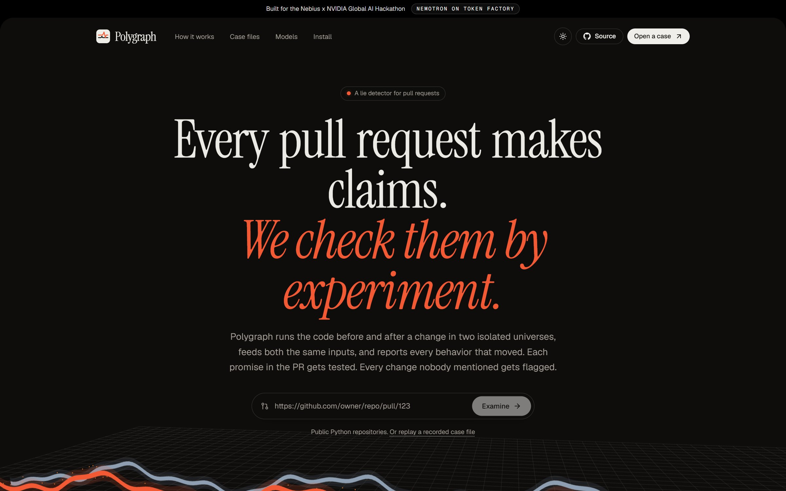
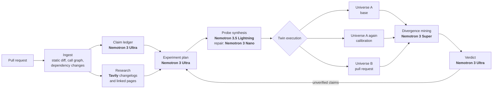

<p align="center">
  
</p>

<h1 align="center">Polygraph</h1>

<p align="center"><b>Every pull request makes claims. Polygraph checks them by experiment.</b></p>

<p align="center">
  <a href="LICENSE"></a>
  
  
  
</p>

Polygraph runs the code before and after a change in two isolated universes, feeds both the same inputs, and
reports every behavior that moved. It reads what the author promised, turns each promise into an experiment, and
flags the behavior changes nobody mentioned. Every finding comes with a reproducible witness and a pytest file you
can commit.

Built for the Nebius x NVIDIA Global AI Hackathon, **Coding and Agentic Engineering** track.

- **Live demo:** https://yvt94-polygraph.static.hf.space (every recorded run replays in your browser)
- **Demo video:** https://youtu.be/VFzUl18uwP8
- **Run it live yourself:** `polygraph pr <github-pr-url>` (see Quick start), or deploy the API for free:

  [](https://render.com/deploy?repo=https://github.com/Thanatos9404/polygraph)
- Deck: [`deck/Polygraph.pdf`](deck/Polygraph.pdf)

---

## The problem

Coding agents now open more pull requests than people can read. Review still means reading a diff, and a diff never
runs. Tests stay green because they only check what someone thought to check. Dependency bumps are worse: the change
lives inside a library, so the diff is one line and there is nothing to read at all.

So reviewers end up trusting the PR description. "No behavior change." "Fixes the crash." "Routine dependency
update." Those sentences are claims, and nobody checks them.

## What Polygraph does

Point it at a pull request. It produces a **claim ledger** and a **verdict**:

| Claim status | Meaning |
|---|---|
| Confirmed | Experiments show the behavior the PR describes |
| Contradicted | Experiments show behavior that conflicts with the PR |
| Unverified | No experiment produced evidence either way, and Polygraph says what would settle it |

Plus every **undeclared behavior change**: inputs where the old and new code disagree that no claim accounts for.

Verdicts are `consistent`, `needs review`, `inconsistent`, or `inconclusive` (nothing could be executed, so Polygraph
refuses to judge).

### Example: a one-line dependency bump

`chore(deps): bump packaging from 21.3 to 24.1`, "routine maintenance, no code changes required", tests green.

| | Diff-reading review (Nemotron 3 Ultra) | Polygraph |
|---|---|---|
| Verdict | Approve | Inconsistent |
| Behavior changes found | 0 | 5 undeclared, each with a witness |
| Example | | `sort_versions(['1.0.0', 'invalid.version'])` returned a list, now raises `InvalidVersion` |
| Why | "Routine maintenance" | Tavily read the official changelog: `LegacyVersion` was removed in 22.0 |

The recorded run is in [`recorded/case-packaging-bump.json`](recorded/case-packaging-bump.json) and replays in the web app.

## How it works



1. **Ingest.** Both trees are parsed with `ast`. Changed functions, their public callers (up to three hops), and any
   function that uses a name imported from a bumped dependency become targets. Private helpers are probed through
   their public entry points so findings are things a real caller can hit.
2. **Claim ledger.** Nemotron 3 Ultra splits the title, description, commits, and linked issues into separate claims,
   including implicit ones such as "no behavior change" for a refactor or a dependency bump.
3. **Research.** For dependency bumps, Polygraph finds the package's official sites on PyPI, scopes a Tavily Search to
   them, and uses Tavily Extract to pull the changelog entries between the two versions. Links in the PR body are
   extracted too. The notes go to the planner, which aims experiments at what the changelog says moved.
4. **Experiment plan.** Ultra sees both versions of every target and writes falsifiable hypotheses: which inputs
   should behave differently, and why.
5. **Probe synthesis.** Nemotron 3.5 Lightning writes one executable probe per experiment, in parallel. Probes that
   fail identically in both universes are bugs in the probe, so Nemotron 3 Nano repairs them, and Lightning rewrites
   them from scratch if the repair does not compile. Import failures inside the project are classified as
   environment problems and are not "repaired".
6. **Twin execution.** Every probe runs in universe A, again in A, and in B. Inputs where A disagrees with itself are
   noise and are discarded. Each universe gets its own interpreter and, when the project is installable, its own venv
   with the project installed editable, so a dependency bump really runs two library versions side by side. The
   project's own pytest suite runs in both universes too. Every agreeing input is micro-benchmarked, which settles
   speed claims with data.
7. **Divergence mining.** Disagreements are clustered by function and kind, de-duplicated across probes, and Nemotron
   3 Super explains each cluster and picks the most convincing witness.
8. **Verdict.** Ultra rules on every claim and every divergence. Testable claims left unverified trigger a second round
   of targeted experiments. The final label is computed in code from the ledger, not taken from the model.

### Why four Nemotron models

| Stage | Model | Why this tier |
|---|---|---|
| Claims, plan, verdict | `nvidia/Nemotron-3-Ultra-550b-a55b` | Long-context reasoning over the PR and both versions of the code. Few calls, high stakes. |
| Divergence explanations | `nvidia/nemotron-3-super-120b-a12b` | Short, parallel, needs good judgement on severity. |
| Probe synthesis | `nvidia/Nemotron-3_5-Lightning` | Many parallel code-writing calls. 1M context, very cheap. |
| Probe repair | `nvidia/NVIDIA-Nemotron-3-Nano-30B-A3B` | Small, fast fixes to a known error. |

A full examination costs about **$0.03 to $0.06** on Token Factory. Every call is metered and shown in the UI.

## Where Nebius fits

- **Token Factory inference** powers every reasoning step through the OpenAI-compatible API, with reasoning toggled per
  call through `chat_template_kwargs` and JSON mode where it helps.
- **Token Factory Sandboxes** (beta) is a drop-in executor: `POLYGRAPH_EXECUTOR=nebius`. Each universe becomes an
  immutable sandbox image (source plus pinned dependencies plus an editable install), and every probe runs as a
  disposable operation branched from it. This is the "branch, compare" pattern the Sandboxes docs describe, applied
  to code review. See [`polygraph/sandbox/nebius.py`](polygraph/sandbox/nebius.py).
- **Serverless Endpoints**: the Docker image serves the web app and API from one container on port 7860.

## Spending protection

Polygraph is built to run on free credits without surprises.

- Every model call **reserves its worst-case cost** (prompt estimate plus `max_tokens` of output) before it is sent and
  settles to the metered cost after. A call that could cross any cap is refused before it leaves the process, so
  parallel calls cannot overshoot.
- Caps: lifetime, daily, per run, and Tavily credits per day. Ledger persisted in `POLYGRAPH_WORKDIR/budget.json`.
- The public web app replays recorded runs for free. Live runs need `POLYGRAPH_ACCESS_CODE`, are rate limited per
  client and globally, and are capped in concurrency.

| Variable | Default (local) | Default (Docker) |
|---|---|---|
| `POLYGRAPH_BUDGET_USD` | 20 | 10 |
| `POLYGRAPH_DAILY_BUDGET_USD` | 2 | 1.5 |
| `POLYGRAPH_RUN_BUDGET_USD` | 0.35 | 0.25 |
| `POLYGRAPH_RUNS_PER_HOUR` / `_PER_DAY` | 4 / 10 | 3 / 6 |
| `POLYGRAPH_TAVILY_DAILY_CREDITS` | 25 | 20 |

## Quick start

```bash
git clone https://github.com/Thanatos9404/polygraph && cd polygraph
uv venv && uv pip install -e ".[dev]"
cp .env.example .env    # add NEBIUS_API_KEY, optionally TAVILY_API_KEY
```

Examine a public pull request:

```bash
polygraph pr https://github.com/python-humanize/humanize/pull/392
```

Two refs of a local repository (use `WORKTREE` for uncommitted changes):

```bash
polygraph local path/to/repo --base main --head my-branch
```

A bundled case file:

```bash
polygraph scenario packaging-bump
```

The web app:

```bash
cd web && npm ci && npm run build && cd ..
polygraph serve        # http://localhost:7860
```

The CLI exits with code 1 on an `inconsistent` verdict, so it can gate merges.

### GitHub Action

```yaml
name: polygraph
on: pull_request
jobs:
  examine:
    runs-on: ubuntu-latest
    steps:
      - uses: actions/checkout@v4
        with: { fetch-depth: 0 }
      - uses: Thanatos9404/polygraph@main
        with:
          nebius-api-key: ${{ secrets.NEBIUS_API_KEY }}
```

It posts the claim ledger as a PR comment and uploads `test_polygraph_pinned.py`: one test per finding. Undeclared
changes are pinned to the base behavior, so the test fails on the PR until the change is declared or reverted.

### Docker / Hugging Face Spaces

```bash
docker build -t polygraph .
docker run -p 7860:7860 -e NEBIUS_API_KEY=... -e POLYGRAPH_ACCESS_CODE=... polygraph
```

Free hosting used for the demo: the web app is built in static mode (`python scripts/build_pages.py --base /`) and
served from a Hugging Face Static Space, where recorded runs replay entirely in the browser. The live API deploys to
Render's free tier from `render.yaml`; set `VITE_API_BASE` at build time to point the static site at it.

## Case files

| Case | What the PR says | Verdict |
|---|---|---|
| `slugkit-refactor` | An agent's cleanup: "No behavior change. All existing tests pass." | Inconsistent: `slugify('Straße')` went from `strasse` to `strae`, truncation now cuts mid-word; tests green, 2x speedup confirmed by timing |
| `duration-fix` | Fixes a crash, adds compound durations, adds a `d` unit | Inconsistent: two promises hold, `2d` still fails, `'-5'` now raises and `'90sabc'` now parses as 90 |
| `packaging-bump` | "Routine maintenance, no code changes required" | Inconsistent: non-PEP 440 version strings now raise |
| `price-rounding` | Half-up rounding fix, "only exact halves change" | Consistent: every divergence is declared |
| `python-humanize#381` | Real merged PR: accept any iterable in `natural_list` | Needs review: `natural_list(None)` returned `''` and now raises `TypeError`, mentioned nowhere |
| `python-humanize#392` | Real merged PR: fix `intcomma` overflow on huge integers | Needs review: fix confirmed with a huge-integer witness; only the environment-dependent test count differs |

## Control arm: does reading work?

[`polygraph/baseline.py`](polygraph/baseline.py) asks the same Nemotron 3 Ultra to review each PR by reading the diff,
and to predict behavior changes as concrete calls. Polygraph then executes every predicted call in both universes.

| Case | Reader verdict | Predicted changes | Real when executed | Polygraph undeclared |
|---|---|---|---|---|
| slugkit-refactor | Request changes | 3 | 3 | 4 |
| duration-fix | Request changes | 6 | 6 | 3 |
| packaging-bump | **Approve** | **0** | n/a | **5** |
| price-rounding | Approve | 1 | 1 | 0 |
| python-humanize#381 (real) | **Approve** | 4 | 4 | **2**, including `natural_list(None)` |
| python-humanize#392 (real) | Approve | 2 | 2 | 0 |

A strong model reading a small, visible diff predicts real changes, and every executable prediction it made here was
real. But it approved the dependency bump with nothing to say, and approved a real merged PR whose `None` handling
silently changed. When the change lives outside the diff, or in an input nobody thought of, reading has nothing to
work with. Polygraph treats any reviewer's predictions, human or model, as hypotheses and executes them.

## Repository layout

```
polygraph/
  engine.py        pipeline orchestration and verdict logic
  analysis.py      AST diff, call graph, dependency-aware targeting
  llm.py           Token Factory client, tier fallbacks, JSON parsing, metering
  budget.py        reservation-based spending caps
  harness.py       in-universe probe runner (stdlib only)
  compare.py       alignment, calibration, clustering, timing
  sandbox/         local and Token Factory Sandboxes executors
  research.py      Tavily changelog and link research
  baseline.py      diff-reading control arm
  report.py        PR comment and pinned pytest generation
  server.py        FastAPI, SSE streaming, rate limits
  cli.py           polygraph pr | local | scenario | record | serve
web/               React, Tailwind, shadcn/ui, Framer Motion, three.js
scenarios/         bundled case files (base, head, PR text)
recorded/          recorded runs the web app replays
tests/             offline test suite
action.yml         GitHub Action
```

## Limits

- Python projects only, for now. The harness, AST analysis, and editable installs are Python specific.
- Probes call public functions in-process. Behavior behind network calls, databases, or GUIs is out of reach unless
  the project exposes a pure function for it.
- Probe generation is stochastic, so the inputs tried differ between runs. Planner witness calls, a follow-up round
  for unverified claims, and calibration reduce the variance; they do not remove it.
- Polygraph executes code from the pull request. Run it in a container or use the Token Factory Sandboxes executor
  for untrusted PRs. The local executor strips credentials from the environment of every universe.

## License

Apache 2.0. See [LICENSE](LICENSE).
